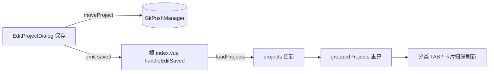

## 用户需求

将 gitPush 项目卡片顶栏的「分类调整」下拉（移动分类）从卡片移除，功能合并进「编辑项目」弹窗（EditProjectDialog），让分类变更与其他项目元信息（名称/收藏/归档/备注/路径）在同一处编辑、一次保存。

## 产品概述

- 卡片顶栏操作按钮区不再展示分类下拉，减少卡片常驻控件
- 编辑项目弹窗新增「分类」选择项，保存时持久化；保存后父层既有 `loadProjects()` 刷新链路自动将新分类反映到分类 TAB 与卡片归属
- 顺带清理由此产生的死代码链（卡片注入契约 / provide / composable / i18n 键），保持注册链条干净

## 核心功能

- **编辑弹窗新增分类选择**：弹窗自包含加载分类列表（`manager.getCategories()`），回填当前项目 categoryId，共享 `Select` 组件展示（标签复用既有 `category` i18n 键）
- **保存链路**：`updateProjectMeta` 成功后，仅当分类实际变化时调用既有 `manager.moveProject(projectId, categoryId)` 持久化，随后 `emit("saved")` 走父层刷新
- **卡片侧移除**：CardHeaderActions 删除分类 Select 与相关逻辑，同步更新顶栏注释
- **死代码清理**：CardOps 契约、根组件 provide、useGitPush 解构、useProjectCrud.moveProject 四处逐一移除；`moveCategory` i18n 键两侧同步删除
- 保留全部其余功能入口（平台链接/IDE/刷新/编辑/Git配置/删除等）不变

视觉变化：卡片顶栏少一个分类下拉（顶栏更宽松）；编辑弹窗在「名称/标记」行与「备注」之间多一行「分类」下拉。

## 技术栈

既有项目：Vite + Vue 3 + TypeScript 思源插件，gitPush 为单体插件内功能模块；无新增依赖、无架构变更。

## 实现方案

- **编辑弹窗（EditProjectDialog.vue）**
- 新增本地状态：`localCategoryId = ref("")`、`categories = ref<ProjectCategory[]>([])`
- `onMounted`：在既有 `getProjectById` 之后追加 `manager.getCategories()`，回填 `localCategoryId = p.categoryId`
- 模板：在「名称/标记」行后、「备注」前插入 `<Select v-model="localCategoryId" :label="i18n.category" size="xsmall" :options="categoryOptions" />`（options 与 AddProjectDialog 同款 `{ value: c.id, label: c.name }` 投影）
- `save()`：updateProjectMeta 成功后，`if (localCategoryId.value !== project.value.categoryId)` 则 `await props.manager.moveProject(props.projectId, localCategoryId.value)`（失败走既有 catch 的统一错误提示）；随后既有 `emit("saved")` 触发父层 `handleEditSaved`（含 `loadProjects()` 全量刷新，分类 TAB 与卡片归属自动同步）
- **卡片侧（CardHeaderActions.vue）**
- 删除 Select 模板块、`categories` 解构、`categoryOptions`、`handleCategoryChange`、`Select` 导入，更新文件头与脚本区注释
- `CardHeader.vue` 顶栏注释去掉「分类」字样
- **死代码链清理（自下游向上游）**
- `types/cardServices.ts`：CardOps 移除 `moveProject`
- 根 `index.vue`：ops provide 与 useGitPush 解构移除 `moveProject`
- `composables/useGitPush.ts`：移除 moveProject 转发
- `composables/useProjectCrud.ts`：删除 `moveProject` 函数与导出（确认无其他消费者）
- **i18n**：`src/i18n/zh_CN/gitPush.json` 与 `en_US/gitPush.json` 同步删除 `moveCategory` 键（`category` 键保留，弹窗复用）

## 架构设计

数据流不变：EditProjectDialog（自包含，manager 直连）→ `emit("saved")` → 根组件 `handleEditSaved`（`scheduler.clearProject` + `loadProjects` + `ensureProjectStatus`）→ `useGitStats.groupedProjects` 重算 → 分类 TAB / 卡片自动更新。卡片区块仍走 CARD_SERVICES_KEY 注入，仅契约项减少一条。



## 目录结构

```
src/features/gitPush/
├── components/
│   ├── common/
│   │   └── EditProjectDialog.vue    # [MODIFY] 新增分类 Select（getCategories 加载 + moveProject 保存）
│   └── ListView/
│       ├── CardHeaderActions.vue    # [MODIFY] 移除分类 Select 及相关逻辑，更新注释
│       └── CardHeader.vue           # [MODIFY] 顶栏注释去掉「分类」
├── composables/
│   ├── useProjectCrud.ts            # [MODIFY] 删除 moveProject 函数与导出
│   └── useGitPush.ts                # [MODIFY] 移除 moveProject 转发
├── types/
│   └── cardServices.ts              # [MODIFY] CardOps 移除 moveProject
├── index.vue                        # [MODIFY] 删 ops provide 与 useGitPush 解构中的 moveProject
src/i18n/
├── zh_CN/gitPush.json               # [MODIFY] 删 moveCategory 键
└── en_US/gitPush.json               # [MODIFY] 删 moveCategory 键
```

## 执行要点

- 弹窗 Select 复用共享组件，不改 `Select.vue` 本体
- `moveProject` 仅在分类实际变化时调用，避免无谓写盘；失败不阻塞其余字段已保存的事实（错误经 showMessage 提示）
- 类型检查必须用 `pnpm typecheck`（vue-tsc）；验证链：read_lints + typecheck + i18n:verify + test
- 不新建临时校验脚本；README / changelog 待用户确认效果后与此前两批合并补齐